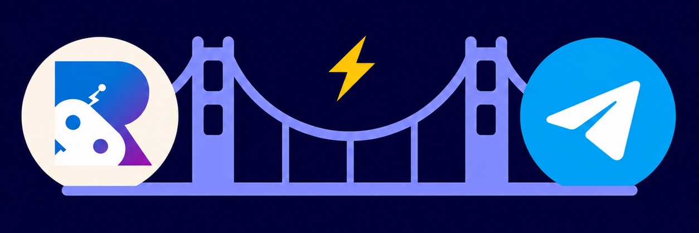
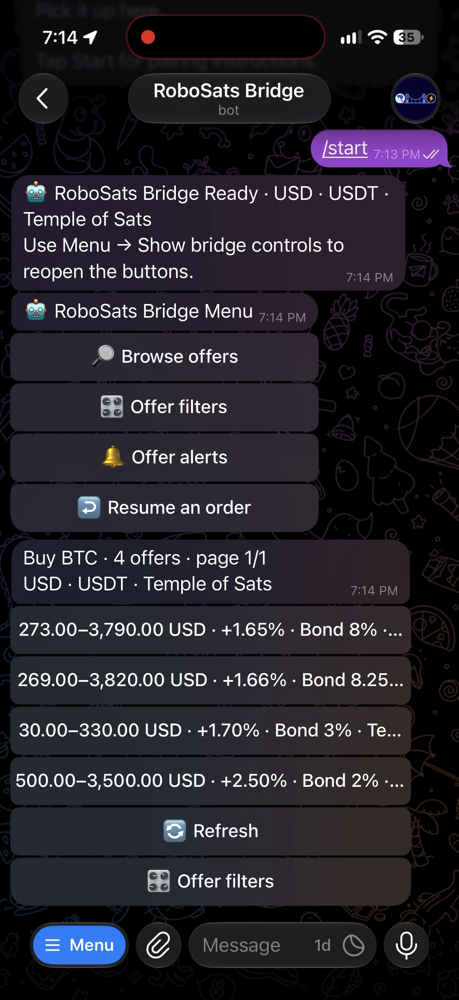
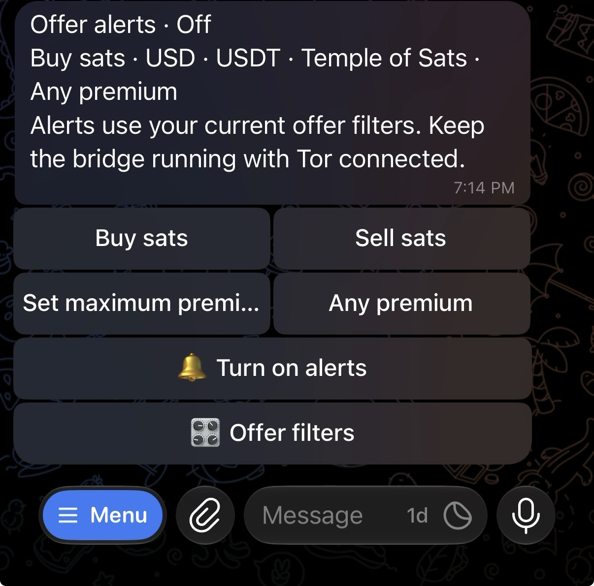
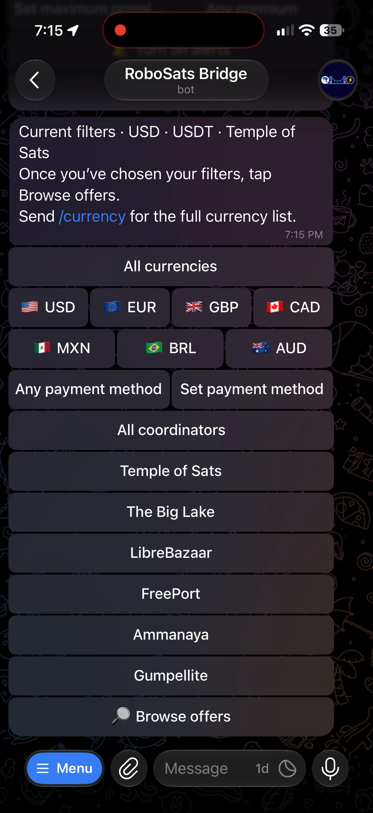
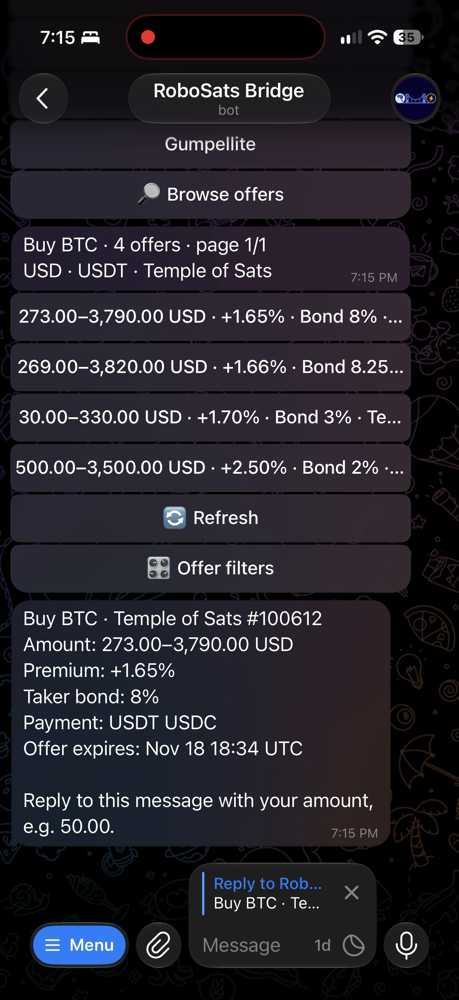
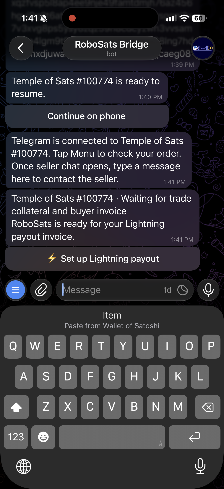
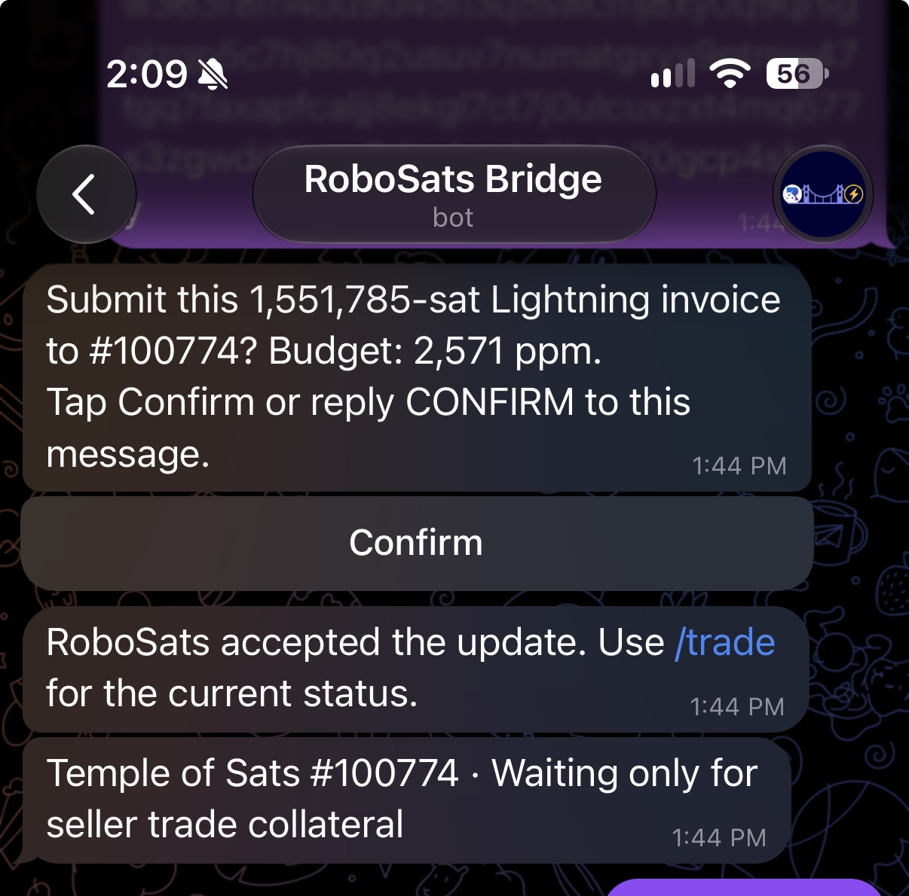

# RoboSats Telegram Bridge

**Start the bridge on your computer, walk away, and buy bitcoin on RoboSats from your phone.** You can browse and take an offer, chat with the seller, confirm payment, and follow your Lightning payout from your own Telegram bot.

**Create your own bot once, then use it for every trade.** Your bot gives you a private chat for your orders, seller messages, and updates from the bridge running on your computer. On your phone, tap the link to BotFather, tap **Start** if shown, and send `/newbot`. BotFather asks for a display name and a username, then gives you a token to paste into the bridge. Once the required tools are installed and Tor is connected, you can pair in a few minutes. A dedicated bot you already own works too. [Open BotFather in Telegram](https://t.me/BotFather) · [Follow the pairing steps](#2-create-and-connect-your-telegram-bot)

Before you leave, connect to Tor, double-click **Start RoboSats Bridge** on your Mac or Windows PC, and wait for **Bridge ready**. After one-time setup, you can do the rest from your phone. If you chose to keep your Garage Key for one session only, enter it again each time you start the bridge to trade. The bridge automatically prevents idle sleep using macOS `caffeinate` or the built-in Windows equivalent. You can lock the screen and head out. Keep the launcher open, the computer online, and Tor connected. Leave the lid open if closing it puts your laptop to sleep.

When you’re ready to buy, open your private bot chat on your phone and tap **Browse offers**. The bot gives you the bond invoice and lets you set your Lightning routing budget and submit your payout invoice. Use your Lightning wallet and usual payment app on the same phone to make the payments. The seller releases escrow through RoboSats.

The bridge uses the **RoboSats coordinator API** for order actions and supports both **Nostr trade chat** and **coordinator API chat**.

This independent project supports **mainnet BTC buy orders taken from the public book**. The bridge lists Temple of Sats, The Big Lake, LibreBazaar, FreePort, Ammanaya, and Gumpellite using their mainnet Tor addresses from the [RoboSats federation roster](https://github.com/RoboSats/robosats/blob/main/frontend/static/federation.json). You can switch devices during a trade in either direction. [Continue a desktop order on your phone](#resume-a-buy-order-from-desktop) or [open a Telegram-started order on desktop](#continue-a-telegram-order-on-desktop).

## 1. Install

On this GitHub page, choose **Code → Download ZIP** and extract it. Follow the guide for your computer to check for Python, Node.js with npm, and GnuPG. Connect to Tor, then double-click the launcher for your computer. The launcher creates the project’s Python environment and installs the Python and chat libraries automatically. You can also use an existing Python environment by following your platform guide.

| Computer | Setup guide | Start the bridge |
| --- | --- | --- |
| macOS | [macOS setup](SETUP-MACOS.md) | **Start RoboSats Bridge.command** in Finder |
| Windows 10 or 11 | [Windows setup](SETUP-WINDOWS.md) | **Start RoboSats Bridge.cmd** in File Explorer |

On both platforms, use Brave’s private Tor window, Tor Browser, or standalone Tor. The bridge finds Brave’s changing local port automatically.

## 2. Create and connect your Telegram bot

Everyone sets up their own bot and pairs it once. Your bridge sends trade updates to your private chat with that bot. On your next trade, open the same bot on your phone after starting the bridge.

When the bridge starts, it sets up the **Menu** button and sends the first set of buttons to your bot chat. If you don’t see **Menu**, send `/menu`. In BotFather, creating the bot and getting its token is all you need to do. When you’re ready to trade, tap the options in your bot chat. The payout and payment buttons appear when you reach those steps.

1. **Find BotFather on your phone.** Tap [Open BotFather in Telegram](https://t.me/BotFather). If the link opens a browser, tap **Open in Telegram**. You can also open Telegram yourself, tap **Chats**, and search for `@BotFather`. Choose the result with the verification checkmark and tap **Start** if it appears.
2. **Create your bot and copy its token.** In the BotFather chat, type `/newbot` and tap **Send**. Give the bot a display name, such as **My Sats Bridge**. Next, choose a unique `@username` ending in `bot`. This is the name you’ll search for to open your new bot. Copy the entire token BotFather gives you, including the numbers, colon, and characters after it. If you already own a dedicated bot, send `/mybots` in BotFather and select it to find its token. Use a separate bot if another automation still reads your existing bot’s messages.
3. **Enter the token on your computer.** If you also use Telegram on your computer, open the same BotFather chat there to copy the token directly. In the bridge window, paste the token at the setup prompt and press Enter. The prompt hides what you paste. Press **Enter** at the **chat ID** and **Tor SOCKS port** prompts to detect both automatically.
4. **Pair from your phone.** In Telegram, go back to **Chats** and search for the new bot’s `@username` shown in the setup window. Tap **Start** if Telegram shows it, then send the one-time code from the setup window as a normal message in your new bot’s chat. This is the code from the computer, separate from the token BotFather gave you.
5. **Unlock your Garage on the computer.** To trade, paste the `robo1…` key you backed up in RoboSats into the hidden prompt. Choose whether to save it on this computer or use it for this run. Press **Enter** at the Garage Key prompt to browse offers. You can double-click the launcher again when you’re ready to enter the key. If you need a Garage, [create one in RoboSats](https://learn.robosats.org/read/en/) and back up the key. When the terminal says **Bridge ready**, continue on your phone.

Telegram has separate [bot creation instructions](https://core.telegram.org/bots/tutorial#obtain-your-bot-token). Run one copy of the bridge per bot. Enter credentials only in the local terminal. The bridge stores them outside the project folder. On macOS, the settings file is under `~/Library/Application Support/RoboSatsTelegram/` with owner-only permissions. A Garage Key saved there is stored in plaintext. On Windows, settings are under `%LOCALAPPDATA%\RoboSatsTelegram\` and are encrypted for your Windows user with DPAPI.

## 3. Choose filters and use the bot

The bridge sends its main buttons to your bot chat when it starts. Tap **Menu** beside the message box, then **Show bridge controls**, to bring them back at any time while the bridge is running. During a trade, this shows the current order and its available actions. You can also send `/menu` in your bot chat.

### Try it without a trade

When the bridge says **Bridge ready**, tap **Browse offers** in the bot’s startup menu. Try changing an offer filter and browsing the results. Browsing works without selecting a robot or locking a bond.

  

### Get alerts for matching offers

1. Set your currency, payment method, and coordinator under **Offer filters**.
2. Open **Menu → Show bridge controls → Offer alerts** and choose **Buy sats** or **Sell sats**. You can set a maximum premium when buying, a minimum premium when selling, or leave it at **Any premium**.
3. Tap **Turn on alerts**. When an offer matches, tap **View offer** to check whether it’s still available. A buy alert can lead into the bridge’s purchase flow. For a sell alert, open the order in RoboSats using the Tor link in the offer details.

The bridge checks about once a minute while it’s ready to browse. Keep your computer online with the bridge and Tor running. Alerts are optional and use only the public order book, so you can try them without entering your Garage Key. Checking pauses during active trade monitoring and resumes when the bridge returns to browsing. Tap **Pause alerts** on an alert or in **Offer alerts** to stop notifications.

  

### Take a new buy offer from Telegram

1. Tap **Browse offers**. To narrow the list, open **Offer filters** and change the currency, payment method, or coordinator. Each change saves immediately. Once you’ve chosen your filters, tap **Browse offers**. New profiles start with all currencies, any payment method, and all listed coordinators.
2. Open an offer. The offer already identifies its coordinator. When the bridge needs a robot, it checks which of your Garage robots that coordinator recognizes and lets you choose by nickname. Tap **Find more robots** to search the next batch. To use a fresh robot, create it in your existing Garage in RoboSats, open the offer with it there, then search again in Telegram. The same Garage Key works for the new robot. To switch robots, tap **Choose another robot** on the offer review.
3. Review the offer and its taker bond percentage. If it has an amount range, reply to the bot’s prompt with the amount you want to buy. The bot shows an estimated bond in sats when enough pricing data is available. Tap **Confirm take** to get the exact bond invoice from RoboSats. Pay it with a Lightning wallet that supports RoboSats hold invoices, then tap **Continue order** and **Continue on phone** when the order is ready.

If you change your mind before paying the bond, tap **Release offer**, then **Confirm release**. RoboSats may give the robot a short cooldown. This action is available while the bridge can verify that your bond remains unpaid.

  
  

### Resume a buy order from desktop

From your private bot chat, tap **Resume an order** and choose the active order. If it’s missing, tap **Find my order**, pick the coordinator shown on the original order, and choose the matching order number and robot nickname.

### Continue a Telegram order on desktop

After taking an offer through Telegram, open RoboSats on your computer. Select the **same coordinator and robot**, then open the active order and match its number to the one shown in Telegram. Refresh the order status before continuing, especially if you already submitted an invoice or marked a payment as sent. Use RoboSats directly for disputes or when the result of a trade action is unclear.

### Finish the trade

1. When the bot says RoboSats is ready for your payout invoice, tap **Set up Lightning payout**. To change the routing allowance, tap **Change budget in sats** or **Change budget in ppm**, then use Telegram’s **Reply** gesture on the bot’s prompt and enter a whole number. Once the budget is set, create a Lightning invoice for the **exact sat amount in the latest prompt**. Paste it into your private bot chat and confirm.
2. When the trade is ready for payment, you can [message the seller directly from Telegram](#chat-with-the-seller-in-telegram).
3. When the bot says **Ready for payment**, it shows the order amount and currency. Agree on payment details with the seller in chat, then send the payment using the agreed method. Tap **Confirm Sent** only after paying, and complete the follow-up confirmation in Telegram. Watch for the final order status and check the receiving wallet for your Lightning payout.

Keep the RoboSats order available for your first live trade. If Telegram is delayed or a trade action has an uncertain result, check the order in RoboSats before retrying.

  
  

Set up your Lightning payout on your phone, then confirm the invoice and routing budget. Screenshots show an earlier version of the escrow status wording.

### Chat with the seller in Telegram

Unlock your Garage on the computer to use seller chat and payout, then continue on your phone. When RoboSats has locked the seller’s escrow and accepted your payout invoice, the bot can open seller chat. You can keep messaging after marking the payment as sent while you wait for release.

**Look for “Seller chat is open” in Telegram.** The bot sends this once per monitoring session when the order allows messaging and a chat route is available. Type a normal text message in your private bot chat. You can send the first message, for example, “Hi, which network should I use?” Use Telegram’s **Reply** gesture when a trade prompt asks for it, such as when you’re setting a routing budget or typing `CONFIRM`. The bot handles trade buttons, slash commands, and Lightning invoices separately from ordinary seller messages.

Seller replies appear in the same bot chat when the bridge receives them. If the bot says chat is unavailable, use **Menu → Show bridge controls** to check the trade and send your message when seller chat opens. If delivery is uncertain, check the RoboSats chat before retrying.

#### How the API and Nostr work together

- **Order actions** use the coordinator API. This includes browsing and taking offers, checking escrow and order status, submitting payout invoices, and marking the payment as sent.
- **Outgoing chat** uses the routes available for the order. When the order has both traders’ Nostr keys, the bridge tries the Nostr relays. When the coordinator also provides a peer chat key, the bridge also tries its encrypted API chat.
- **Incoming chat** uses Nostr when the order provides both traders’ Nostr keys. For orders without those keys, it forwards replies from the coordinator’s API chat. If Nostr checks keep failing, the bot alerts you to check the chat in RoboSats.

## Restart and troubleshooting

To restart, stop the bridge with **Ctrl+C** in its window and double-click the same launcher. If you use your own Python environment, activate it and run `python robosats_monitor.py` from the project folder.

- **Tor is unavailable.** Check that your Tor Browser or Brave Tor window says it is connected, or that your standalone Tor service is running. Keep the browser window open. The bridge checks ports `9050` and `9150` and looks for Brave’s Tor process. If you already paired the bot and need to change a custom port, stop the bridge and run the launcher with the `settings` argument in a terminal. Use `bash start.sh settings` on macOS or `.\start-windows.cmd settings` in PowerShell from the project folder. Select **Tor SOCKS port**, enter your port, then press **Enter** at the settings menu to exit and restart normally.
- **Pairing timed out or the bot is silent.** During setup, start the launcher again and send the new code as a message in your bot’s private chat. After setup, make sure only one copy of the bridge is using that bot and the launcher shows **Bridge ready**. Send `/menu` from the same private bot chat you paired.
- **A trade button is slow or unresponsive.** Send `/trade` in the private bot chat to request the current status. For a payout or payment confirmation, use Telegram’s **Reply** gesture on the latest confirmation message and type `CONFIRM`. If you already sent an invoice or payment and the result is unclear, check the order in RoboSats before retrying.
- **Mobile actions or chat cannot start.** Check `gpg --version` and `node --version`, then restart after installing any missing tools. On Windows, the bridge also searches standard Gpg4win folders. Make sure you started the bridge with your Garage Key if you want to trade or chat with the seller.

For a read-only authenticated check, select or use a robot for that coordinator first, then add `check --coordinator temple --order ORDER_NUMBER` to the launcher command. Use `lake` for The Big Lake.

## Local tests

Run `npm test` and `python -m unittest discover` in your active environment. With the launcher-created environment, use `.venv/bin/python` on macOS or `.\.venv\Scripts\python.exe` on Windows for the Python command. These tests use mock services or a local WebSocket. They never take orders, pay invoices, or send live Telegram messages. The currency codes and coordinator addresses are based on the [RoboSats source](https://github.com/RoboSats/robosats). See the [RoboSats API documentation](https://learn.robosats.org/docs/api/) for the protocol.
